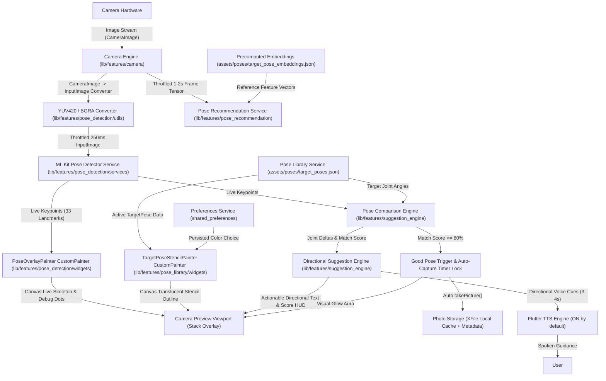

# AI Pose Suggestion App — Technical Documentation Index

Welcome to the technical documentation for the **AI Pose Suggestion App**. This documentation repository contains comprehensive architecture diagrams, multi-phase evolution guides, setup/review instructions, and component API specifications.

---

## 📚 Multi-File Documentation Directory (`docs/`)

The documentation is organized into focused reference guides within the [`docs/`](file:///d:/pose-suggetion/docs) folder:

### 1. 🚀 [Setup, Installation & Review Guide](file:///d:/pose-suggetion/docs/SETUP_AND_RUN.md)
* **Path**: [`docs/SETUP_AND_RUN.md`](file:///d:/pose-suggetion/docs/SETUP_AND_RUN.md)
* **Contents**: Environment prerequisites, Flutter dependencies, Android & iOS permission setup, running instructions (`flutter run`), physical device testing, and step-by-step evaluation walkthrough.

### 2. 📋 [Phase-by-Phase MVP Implementation Guide](file:///d:/pose-suggetion/docs/PHASES_OVERVIEW.md)
* **Path**: [`docs/PHASES_OVERVIEW.md`](file:///d:/pose-suggetion/docs/PHASES_OVERVIEW.md)
* **Contents**: Detailed architectural breakdown of all 9 phases (Phase 0 through Phase 9), key feature implementations, file additions, and verified done conditions.

### 3. 🏗️ [System Architecture & Technical Specifications](file:///d:/pose-suggetion/docs/SYSTEM_ARCHITECTURE.md)
* **Path**: [`docs/SYSTEM_ARCHITECTURE.md`](file:///d:/pose-suggetion/docs/SYSTEM_ARCHITECTURE.md)
* **Contents**: System architecture diagrams, data flow pipelines, 3D vertex angle formulas, MobileCLIP cosine similarity matching equations, coordinate transformations, and front-camera horizontal mirroring logic.

### 4. 🧩 [API & Module Reference](file:///d:/pose-suggetion/docs/API_AND_MODULES_REFERENCE.md)
* **Path**: [`docs/API_AND_MODULES_REFERENCE.md`](file:///d:/pose-suggetion/docs/API_AND_MODULES_REFERENCE.md)
* **Contents**: Complete API contracts and module specifications for all services (`PoseComparisonEngine`, `DirectionalSuggestionEngine`, `TtsSuggestionService`, `PoseRecommendationService`, `PreferencesService`), models, custom painters (`TargetPoseStencilPainter`), and converters.

---

## 1. Quick Project Summary

**AI Pose Suggestion App** is an on-device, real-time AI photography assistant built with Flutter. Designed specifically for selfies and photography assistance, the application captures camera frames locally, detects human body keypoints using Google ML Kit Pose Detection, ranks target reference poses using MobileCLIP (quantized TFLite embeddings), and delivers real-time positioning feedback via visual overlays and voice guidance (`flutter_tts`).

### Core Design Principles
- **Strictly On-Device**: 100% offline runtime execution. Zero cloud/API network calls.
- **Privacy-First**: No camera stream or image data leaves the device.
- **Low-Latency Feedback**: Throttled detection cycles (200-300ms pose detection, 1-2s scene embeddings, 3-4s voice cues).

### Tech Stack Overview

| Domain | Technology / Package | Version / Description |
| :--- | :--- | :--- |
| **Framework** | Flutter / Dart | SDK `>=3.0.0 <4.0.0` |
| **Camera & Video** | `camera` | `^0.10.5+9` Live frame streaming via `startImageStream` & photo capture via `takePicture()` |
| **Pose Detection** | `google_mlkit_pose_detection` | `^0.12.0` On-device 3D pose keypoint extraction (33 landmarks) |
| **Rendering** | `CustomPainter` + `Canvas` | Dual-layer stack overlay: `PoseOverlayPainter` + `TargetPoseStencilPainter` |
| **Pose Library** | Bundled JSON (`target_poses.json`) | 10 reference target poses with 3D keypoints & joint angle targets |
| **Scene Matching** | `tflite_flutter` | `^0.10.4` MobileCLIP vector embeddings & cosine similarity pose ranker |
| **Suggestion Engine**| Pure Dart Math Engine | 3D vertex angle comparison, joint deltas, numeric match scoring & rule table |
| **Error Handling** | Plain Fallback Messaging | Non-blocking banners for no-person-detected, low lighting & hardware exceptions |
| **Capture Flow** | Auto-Capture Timer Lock | 1.5s countdown hold on match score $\ge 80\%$ alignment lock |
| **Text-to-Speech** | `flutter_tts` | `^4.0.2` Directional voice feedback (ON by default, 3–4s throttling guard) |
| **Permissions** | `permission_handler` | `^11.3.1` Runtime camera & microphone permission handling |
| **Persistence** | `shared_preferences` | `^2.2.3` User preference storage (`PreferencesService` for stencil color & voice toggle) |

---

## 2. High-Level Data Flow Diagram

