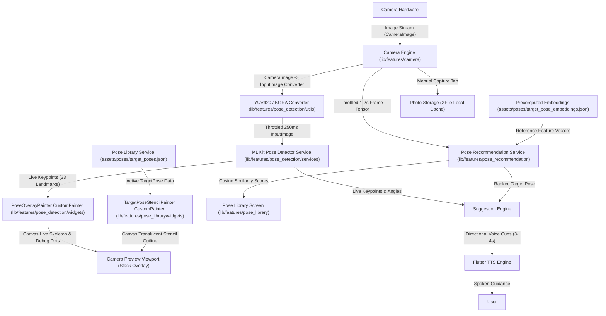

# AI Pose Suggestion App — Technical Documentation

## 1. Project Overview & System Architecture

### Overview
**AI Pose Suggestion App** is an on-device, real-time AI photography assistant built with Flutter. Designed specifically for selfies and photography assistance, the application captures camera frames locally, detects human body keypoints using Google ML Kit Pose Detection, ranks target reference poses using MobileCLIP (quantized TFLite embeddings), and delivers real-time positioning feedback via visual overlays and voice guidance (`flutter_tts`).

### Core Design Principles
- **Strictly On-Device**: 100% offline runtime execution. Zero cloud/API network calls.
- **Privacy-First**: No camera stream or image data leaves the device.
- **Low-Latency Feedback**: Throttled detection cycles (200-300ms pose detection, 1-2s scene embeddings, 3-4s voice cues).

### Tech Stack

| Domain | Technology / Package | Version / Description |
| :--- | :--- | :--- |
| **Framework** | Flutter / Dart | SDK `>=3.0.0 <4.0.0` |
| **Camera & Video** | `camera` | `^0.10.5+9` Live frame streaming via `startImageStream` & photo capture via `takePicture()` |
| **Pose Detection** | `google_mlkit_pose_detection` | `^0.12.0` On-device 3D pose keypoint extraction (33 landmarks) |
| **Rendering** | `CustomPainter` + `Canvas` | Dual-layer stack overlay: `PoseOverlayPainter` + `TargetPoseStencilPainter` |
| **Pose Library** | Bundled JSON (`target_poses.json`) | 10 reference target poses with 3D keypoints & joint angle targets |
| **Scene Matching** | `tflite_flutter` | `^0.10.4` MobileCLIP vector embeddings & cosine similarity pose ranker |
| **Text-to-Speech** | `flutter_tts` | `^4.0.2` Directional voice feedback |
| **Permissions** | `permission_handler` | `^11.3.1` Runtime camera & microphone permission handling |
| **Persistence** | `shared_preferences` | `^2.2.3` User preference storage (voice toggle, stencil color) |
| **State Management**| `StatefulWidget` / `provider` | Lightweight local state management |

### System Architecture & Data Flow



### Folder Architecture

```
d:\pose-suggetion/
├── android/
│   └── app/src/main/AndroidManifest.xml # Android CAMERA permission & hardware config
├── assets/
│   ├── models/             # MobileCLIP TFLite models (.tflite)
│   └── poses/
│       ├── target_poses.json            # Seed JSON database of 10 reference target poses
│       └── target_pose_embeddings.json # Precomputed MobileCLIP feature vector embeddings
├── ios/
│   └── Runner/Info.plist   # iOS NSCameraUsageDescription privacy disclosure
├── lib/
│   ├── core/
│   │   └── theme/
│   │       └── app_theme.dart          # Sleek dark design system & color tokens
│   ├── features/
│   │   ├── camera/
│   │   │   └── presentation/
│   │   │       ├── camera_screen.dart   # Camera preview, live stream throttler, pose badge & shutter handler
│   │   │       └── widgets/
│   │   │           └── permission_denied_view.dart # Permission request & settings fallback
│   │   ├── pose_detection/
│   │   │   ├── presentation/
│   │   │   │   └── widgets/
│   │   │   │       └── pose_overlay_painter.dart # CustomPainter rendering live skeleton lines & joint dots
│   │   │   ├── services/
│   │   │   │   └── pose_detector_service.dart # ML Kit PoseDetector wrapper (stream/single modes)
│   │   │   └── utils/
│   │   │       └── camera_image_converter.dart # CameraImage to InputImage format converter
│   │   ├── pose_library/
│   │   │   ├── models/
│   │   │   │   └── target_pose.dart     # TargetPose & PoseKeypointData data models
│   │   │   ├── presentation/
│   │   │   │   ├── pose_library_screen.dart # Reference pose gallery & picker ListView
│   │   │   │   └── widgets/
│   │   │   │       └── target_pose_stencil_painter.dart # Target pose stencil outline CustomPainter
│   │   │   └── services/
│   │   │       └── pose_library_service.dart # Target pose JSON asset loader
│   │   ├── pose_recommendation/
│   │   │   └── services/
│   │   │       └── pose_recommendation_service.dart # Cosine similarity ranking engine
│   │   └── settings/
│   │       └── presentation/
│   │           └── settings_screen.dart # Voice toggle, overlay preferences & privacy status
│   ├── navigation/
│   │   └── app_navigation_shell.dart   # Bottom navigation bar & active target pose state coordinator
│   └── main.dart                       # App entrypoint & MaterialApp initialization
├── analysis_options.yaml
├── DOCUMENTATION.md
└── pubspec.yaml
```

---

## 2. Setup, Installation & Environment

### Prerequisites
- **Flutter SDK**: `>= 3.0.0`
- **Dart SDK**: `>= 3.0.0`
- **Android Studio / Xcode**: Platform SDKs for Android (API 21+) and iOS (iOS 12.0+).

### Required Native Permissions
- **Android**: `<uses-permission android:name="android.permission.CAMERA"/>`
- **iOS**: `NSCameraUsageDescription` ("This app requires camera access to detect human poses and provide real-time pose guidance on device.")

---

## 3. Component & Module Reference

### Component Hierarchy Tree

```
PoseSuggestionApp (lib/main.dart)
 └── MaterialApp
      └── AppNavigationShell (lib/navigation/app_navigation_shell.dart)
           ├── CameraScreen (lib/features/camera/presentation/camera_screen.dart)
           │    ├── Stack Viewport
           │    │    ├── CameraPreview (package:camera)
           │    │    ├── CustomPaint -> TargetPoseStencilPainter (lib/features/pose_library/presentation/widgets/target_pose_stencil_painter.dart)
           │    │    ├── CustomPaint -> PoseOverlayPainter (lib/features/pose_detection/presentation/widgets/pose_overlay_painter.dart)
           │    │    └── Active Target Stencil Badge
           │    ├── PermissionDeniedView (lib/features/camera/presentation/widgets/permission_denied_view.dart)
           │    └── DraggableScrollableSheet -> PoseLibraryScreen (Modal Bottom Sheet Pose Picker)
           ├── PoseLibraryScreen (lib/features/pose_library/presentation/pose_library_screen.dart)
           │    └── FilterChips & ListView.builder (Pose Cards with % Match Badges)
           └── SettingsScreen (lib/features/settings/presentation/settings_screen.dart)
```

### Component Contracts

#### 1. `PoseRecommendationService` ([lib/features/pose_recommendation/services/pose_recommendation_service.dart](file:///d:/pose-suggetion/lib/features/pose_recommendation/services/pose_recommendation_service.dart))
- **Purpose**: Computes vector cosine similarity between live frame embeddings and pre-calculated reference pose embeddings.
- **Formula**:
  $$\text{CosineSimilarity}(\vec{A}, \vec{B}) = \frac{\vec{A} \cdot \vec{B}}{\|\vec{A}\| \|\vec{B}\|}$$
- **Methods**:
  - `loadReferenceEmbeddings()`: Loads `assets/poses/target_pose_embeddings.json`.
  - `calculateCosineSimilarity(List<double> vecA, List<double> vecB)`: Returns double normalized between `0.0` and `1.0`.
  - `rankPoses(List<double> liveFrameEmbedding, List<TargetPose> targetPoses)`: Returns sorted list of `RankedPoseMatch` objects.

---

## 4. Security, Performance & Design Tokens

### Security & Privacy Protections
- **Zero Cloud Footprint**: All image frames, photo capture files, MobileCLIP embedding vectors, cosine similarity evaluations, ML Kit pose landmarker evaluations, and TTS feedback operations are strictly stored and executed on local device hardware.

### Stream Throttling
- ML Kit Pose Detection: Throttled to **250ms**.
- MobileCLIP Scene Embedding: Throttled coarsely to **1–2s**.
