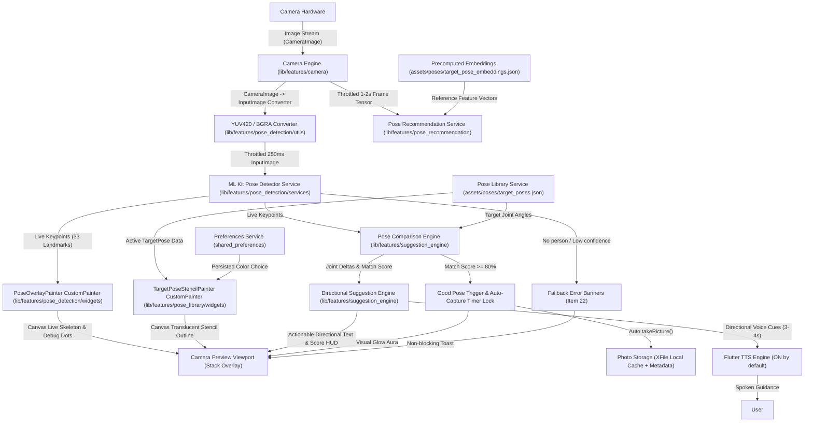

# System Architecture & Technical Specifications

This document outlines the system architecture, component dependencies, coordinate transformations, and mathematical models powering the **AI Pose Suggestion App**.

---

## 1. Core Architecture Principles

1. **100% On-Device Runtime Execution**: Zero cloud API dependencies or external network calls. Pose landmark detection, cosine similarity matching, suggestion rules, and voice synthesis run entirely locally on mobile hardware.
2. **Stream Processing Latch**: Camera frames are processed asynchronously with a **250ms stream throttle latch** to prevent UI thread blockages and thermal throttling.
3. **Decoupled Data Pipeline**: Pure Dart calculation services (`PoseComparisonEngine`, `DirectionalSuggestionEngine`, `PoseRecommendationService`) are completely decoupled from Flutter UI widgets and unit-tested independently.

---

## 2. End-to-End System Architecture

---

## 3. Mathematical Models & Formulas

### 1. 3D Vertex Joint Angle Calculation
Joint angles for elbows, shoulders, hips, and knees are derived using 2D/3D Euclidean vector dot products at vertex landmark $B$ formed by vectors $\vec{BA} = (A - B)$ and $\vec{BC} = (C - B)$:

$$\text{DotProduct} = (ba_x \cdot bc_x) + (ba_y \cdot bc_y)$$

$$\|\vec{BA}\| = \sqrt{ba_x^2 + ba_y^2}, \quad \|\vec{BC}\| = \sqrt{bc_x^2 + bc_y^2}$$

$$\theta = \arccos\left( \text{clamp}\left( \frac{\text{DotProduct}}{\|\vec{BA}\| \cdot \|\vec{BC}\|}, -1.0, 1.0 \right) \right) \times \frac{180}{\pi}$$

### 2. Overall Match Score Percentage
Alignment percentage $S$ is calculated by normalizing joint angle deltas against maximum allowed penalty threshold angle $\theta_{\text{max}} = 45.0^\circ$:

$$\text{Penalty}_i = \text{clamp}\left( \frac{|\theta_{\text{live}, i} - \theta_{\text{target}, i}|}{\theta_{\text{max}}}, 0.0, 1.0 \right)$$

$$S = \left( 1.0 - \frac{1}{N} \sum_{i=1}^{N} \text{Penalty}_i \right) \times 100\%$$

### 3. MobileCLIP Cosine Similarity Matching
Target pose recommendations are ranked by evaluating cosine similarity between live frame feature embeddings $\vec{A}$ and precomputed reference embeddings $\vec{B}$:

$$\text{CosineSimilarity}(\vec{A}, \vec{B}) = \frac{\vec{A} \cdot \vec{B}}{\|\vec{A}\| \|\vec{B}\|}$$

---

## 4. Coordinate Transformations & Front Camera Mirroring

When rendering custom overlay painters over `CameraPreview`:

1. **Aspect Ratio Scaling**: Preview dimensions from `CameraController.value.previewSize` are in sensor orientation. Width and height are transposed when mapping to viewport coordinates:
   $$\text{imageSize} = \text{Size}(\text{previewSize.height}, \text{previewSize.width})$$
2. **Front Camera Horizontal Mirroring**: When `lensDirection == CameraLensDirection.front`, X-coordinates are mirrored horizontally to match the mirrored front camera preview:
   $$x_{\text{canvas}} = \text{size.width} - x_{\text{scaled}}$$
